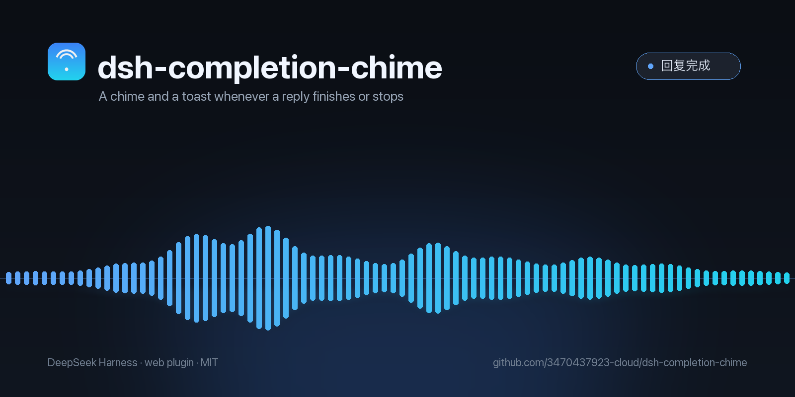

# dsh-completion-chime

回复一结束就"叮"一声，窗口顶部再弹一个小胶囊。**正常回完响，中途按停止也响。**

A chime and a toast the moment a reply in the viewed conversation ends — whether it finished or you stopped it.

[中文](#中文) · [English](#english)

---

## 中文

### 它做什么

DeepSeek Harness 里一个会话从"运行中"回到"空闲"的那一刻，插件会：

- 用 Web Audio 现场合成两声上行音（E5 → B5），约 0.5 秒，不刺耳
- 在窗口顶部中间弹一个「回复完成」胶囊，4 秒后自动淡出
- **只对当前窗口这个会话响**，子代理跑完不响

正常回复结束、你点了停止、模型报错中断——只要会话停下来，都会触发。

### 为什么是这些设计

| 选择 | 原因 |
| --- | --- |
| 现场合成，不带音频文件 | 插件只有 200 行，不依赖网络和音频解码 |
| 监听会话状态，而不是解析 DOM | 不碰别人的界面，宿主改版也不会坏 |
| 音频上下文常驻 + 前台/隐藏都保持 running | 切到别的 App、最小化窗口时同样能响 |
| 只认当前会话 | 后台别的会话、子代理结束不该打扰你 |

### 安装

需要 DSH **0.2.x**（用到 `uiSession` 服务）。

```bash
git clone https://github.com/3470437923-cloud/dsh-completion-chime.git
dsh plugin --profile <你的 profile> add link:$PWD/dsh-completion-chime
```

或者手动装进 profile：

```bash
cd ~/.dsh/profiles/<你的 profile>
pnpm add "link:/绝对路径/dsh-completion-chime"
```

然后把 `dsh-completion-chime` 加进该目录 `package.json` 的 `dsh.profile.bundles` 数组，重启 DSH。

没有设置页、没有开关——装上就生效，不想要就把它从 bundles 里去掉。

### 兼容性

- DSH Desktop / `dsh web`，0.2.x
- 依赖 `@deepseek-ai/dsh-client-ui-session` 提供的 `uiSession` 服务；0.1.x 的客户端 API 不同，装了不会报错但也不会有声音

### 许可

MIT

---

## English

### What it does

The moment a session in the viewed conversation goes from *running* to *idle*, the plugin:

- Synthesises a two-note rising chime (E5 → B5) with Web Audio — no audio files, no network
- Shows a small "Reply finished" pill at the top of the window for 4 seconds
- Stays silent for other sessions and for subagents

Finishing normally, stopping early, and failing mid-way all trigger it.

### Install

Requires DSH **0.2.x** (it uses the `uiSession` service).

```bash
git clone https://github.com/3470437923-cloud/dsh-completion-chime.git
dsh plugin --profile <profile> add link:$PWD/dsh-completion-chime
```

Or manually:

```bash
cd ~/.dsh/profiles/<profile>
pnpm add "link:/absolute/path/dsh-completion-chime"
```

Then add `dsh-completion-chime` to `dsh.profile.bundles` in that profile's `package.json` and restart DSH.

No settings page, no toggle: installing it is the switch.

### How it works

```
lib/index.js   host half — empty; the browser half owns everything
lib/client.js  browser half — session status → Web Audio + overlay toast
```

It subscribes to `ctx.uiSession.sessionStatus`, looks for a `running: true → false` transition on the session currently bound to the main view, and reacts. Nothing is read from the DOM and no other plugin's markup is touched.

### License

MIT
